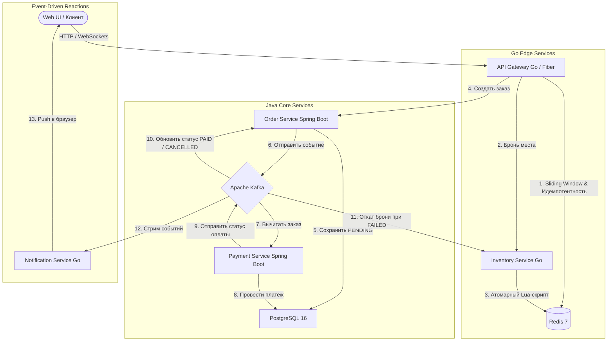

# Распределенная event-driven платформа экспресс-бронирования билетов (Flash-Sale Engine)

[](https://www.oracle.com/java/)
[](https://spring.io/projects/spring-boot)
[](https://golang.org/)
[](https://kafka.apache.org/)
[](https://redis.io/)
[](https://www.postgresql.org/)
[](https://www.docker.com/)

Полиглотная событийно-ориентированная микросервисная платформа для обработки пиковых нагрузок при продаже билетов и flash-распродажах.

Система гарантирует **полное отсутствие овербукинга (0 Race Conditions)**, **согласованность в конечном счете (Eventual 
Consistency)**, **идемпотентность транзакций** и **рассылку статусов в реальном времени через WebSockets**.
---
## Архитектура системы

В проекте применен паттерн **Database-per-Service**: высокопроизводительный слой приема трафика и кэширования на **Go** 
отделен от транзакционного ядра на **Java (Spring Boot)**. Межсервисное взаимодействие организовано асинхронно через шину событий **Apache Kafka**.


## Ключевые инженерные решения и паттерны

* **Защита от овербукинга (Redis Lua):** Бронирование остатков выполняется атомарным скриптом на языке Lua внутри оперативной памяти Redis. Это полностью исключает состояние гонки (Race Condition) при одновременных параллельных запросах.
* **Идемпотентность (`X-Idempotency-Key`):** API Gateway кэширует ответы в Redis. Повторные запросы с тем же UUID при сетевых сбоях возвращают сохраненный результат за `<4ms` без повторных списаний билетов или денег.
* **Sliding Window Rate Limiter:** Защита шлюза от DDoS и спама на базе структур данных Redis Sorted Sets (`ZSET`).
* **Saga Orchestration & Compensation (Откаты):** Если платеж отклоняется (`price > 100 000`), `Payment Service` публикует статус `FAILED`; `Order Service` переводит заказ в `CANCELLED`, а `Inventory Service` асинхронно возвращает билет на склад в Redis (`INCR`).
* **Dead Letter Queue (DLQ / DLT):** «Ядовитые» сообщения (`price == 666`), вызывающие критический сбой после 3 автоматических ретраев, изолируются в топик `orders-topic.DLT` с диагностическими заголовками.
* **Real-Time WebSockets:** Потокобезопасный Hub на Go рассылает мгновенные пуш-уведомления об изменении статусов оплаты прямо в браузер пользователя.
* **Multi-Stage Docker Builds:** Многоэтапная сборка контейнеров снижает размер Go-сервисов до `~15 МБ`, а Java-сервисов — до `~150 МБ`.

---

## Результаты нагрузочного тестирования (K6 Benchmarks)

Сценарий симуляции Flash-Sale (100 одновременных виртуальных пользователей в течение 17 секунд):

| Метрика | Значение | Описание |
| :--- | :--- | :--- |
| **Всего запросов** | **12 460 reqs** | Суммарный объем обработанного трафика |
| **Пропускная способность (RPS)** | **~727 reqs/sec** | На локальном стенде в Docker |
| **Медианная задержка (Median)** | **2.74 ms** | Валидация на шлюзе и фильтрация в Redis |
| **p95 Latency** | **102 ms** | Сквозной отклик под максимальной нагрузкой |
| **Успешность проверок (Checks)**| **100.00%** | 0% неконтролируемых сбоев (`5xx`), корректная отсечка (`201`/`409`/`429`) |
| **Целостность данных** | **0 перепродаж** | Количество проданных билетов строго равно остатку |

---

## Технологический стек

* **Сетевой слой & Highload:** Go 1.23+, Fiber v2, `segmentio/kafka-go`, `go-redis/v9`, Fiber WebSockets.
* **Транзакционное ядро:** Java 21, Spring Boot 3.3+, Spring Data JPA, Spring Kafka, Hibernate, Jackson JSR-310.
* **Базы данных & Брокер:** PostgreSQL 16, Redis 7 (Alpine), Apache Kafka 3.7 (в режиме KRaft).
* **Инфраструктура & UI:** Docker Compose, AKHQ, Tailwind CSS, K6 (Grafana).

---

## Быстрый запуск (в 1 команду)

### 1. Требования
* Установленный и запущенный [Docker Desktop](https://www.docker.com/).
* Установленный [K6](https://k6.io/) *(опционально, для запуска тестов)*.

### 2. Сборка и запуск кластера
```bash
git clone https://github.com/KarpovVsevolod/distributed-flash-sale-platform.git
cd distributed-flash-sale-platform
# Сборка и запуск всех 10 контейнеров (сервисы + базы + Kafka)
docker compose up --build -d
```

### 3 Доступные дашборды и сервисы
* **Веб-интерфейс дашборда:** Открыть frontend/index.html в браузере (или через python -m http.server 5500 по адресу http://localhost:5500).
* **Панель управления Kafka (AKHQ):** http://localhost:8080
* **Система трассировки (Jaeger):** http://localhost:16686
* **Точка входа API Gateway:** http://localhost:3000

## Запуск нагрузочных тестов

```bash
k6 run load-tests/flash_sale_test.js
```

## API (Основные эндпоинты)
| Сервис | Метод | Эндпоинт | Описание |
| :--- | :--- | :--- | :--- |
| **Gateway** | `POST` | `/api/v1/login` | Выдача тестового JWT-токена |
| **Gateway** | `POST` | `/api/v1/buy` | Бронь места и запуск Saga-пайплайна заказа |
| **Inventory** | `POST` | `/api/v1/inventory/init?amount=10` | Завоз билетов на склад (Админ) |
| **Notification** | `WS` | `/ws/:userId` | Real-time поток уведомлений WebSocket |